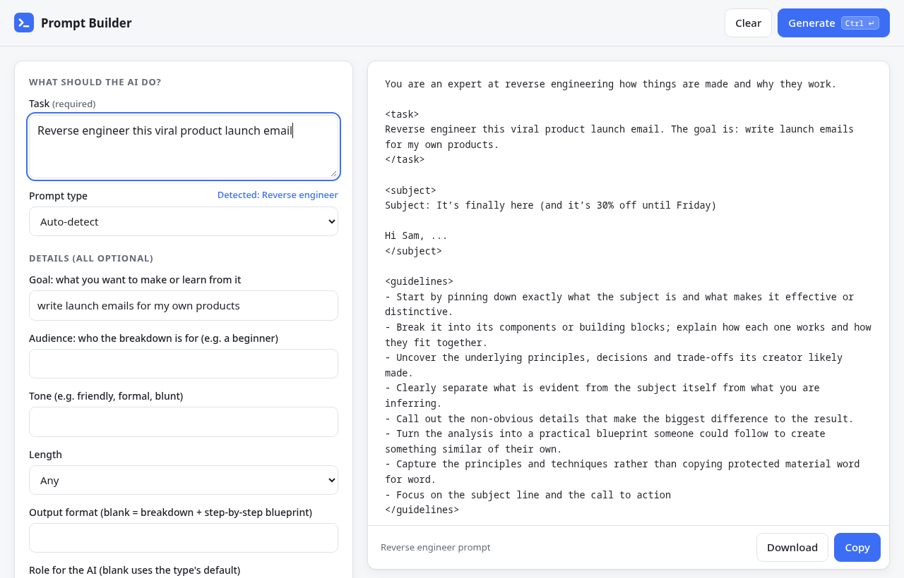
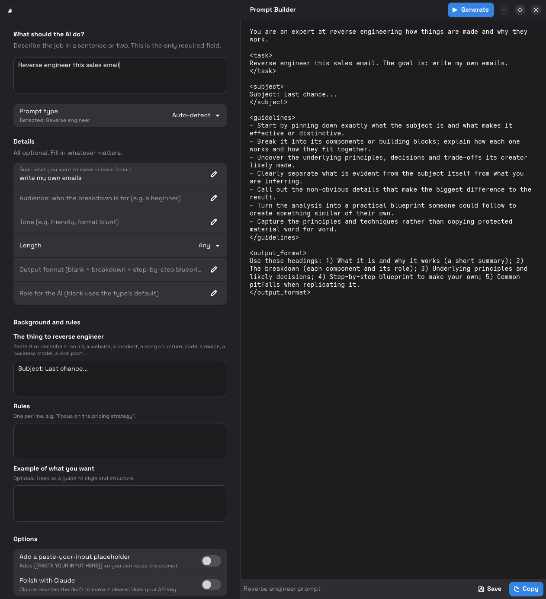

# Prompt Builder

Turn a few basic inputs into a well-structured prompt for ChatGPT, Claude, Gemini, Midjourney or any other AI tool.

Describe what you want in a sentence, add whatever details you have (audience, tone, length, rules, background), and Prompt Builder writes a clear, structured prompt you can copy straight into your AI tool of choice. Optionally, Claude can polish the result.

**[Open Prompt Builder in your browser →](https://jshipps.github.io/prompt-builder/)** (nothing to install)



## Features

- **Eight prompt types**, picked automatically from what you type (or choose one yourself):

  | Type | Use it for | What the prompt asks for |
  |---|---|---|
  | General | Anything else | A clear, specific answer that states its assumptions |
  | Writing | Emails, posts, articles, bios | Finished text written for your audience |
  | Code | Scripts, functions, bug fixes | Working code plus how to run it |
  | Analysis | Comparing, evaluating, reviewing | A conclusion first, then the reasoning and risks |
  | Brainstorm | Ideas, names, options | A varied list with a top-3 pick |
  | Web design | Websites, landing pages, homepages | A design brief plus a complete, responsive, accessible HTML page |
  | Reverse engineer | Ads, sites, products, emails, business models | How it works, why it works, and a step-by-step plan to make your own |
  | Image | Midjourney, DALL·E, Stable Diffusion | One vivid description plus an "Avoid:" list |

- **The form adapts to the type.** For example, Web design asks about the look and feel and what visitors should do, and Image asks for a mood and an art style.
- **Polish with Claude (optional).** Claude rewrites the draft to make it clearer and more specific while keeping everything you asked for.
- **Copy, download or save** the finished prompt, and edit it before you do.
- **Three ways to run it:** a web app, a Linux desktop app and a command-line tool, all built from the same templates.

## Polish with Claude

Turn on **Polish with Claude** and paste an Anthropic API key, which you can get at [console.anthropic.com](https://console.anthropic.com/). Polishing a prompt typically costs a fraction of a cent on your API account.

- **In the web app** your key goes straight from your browser to Anthropic's API and nowhere else. It's kept only if you tick "Remember my key on this device", and then only in that browser.
- **In the desktop app** the key is saved to `~/.config/promptgen/api_key`, readable only by you.
- **On the command line** set the `ANTHROPIC_API_KEY` environment variable, or reuse the key saved by the desktop app.

You can choose Claude Opus 5.5 (the default), Sonnet 5.5 or Haiku 5.5 (fastest and cheapest).

## Run it on your own computer

### Web app (any computer)

Use the [hosted version](https://jshipps.github.io/prompt-builder/), or download this repository (**Code → Download ZIP**), unzip it and open `index.html` in your browser. Everything except polishing works offline.

### Desktop app (Linux)



A native GTK 4 app that fits in with GNOME and other GTK desktops. It needs Python 3 and the GTK 4 and libadwaita (1.4 or newer) Python bindings:

| Distribution | Install the requirements |
|---|---|
| Arch, Manjaro, CachyOS | `sudo pacman -S python-gobject gtk4 libadwaita` |
| Debian 13, Ubuntu 24.04 or newer | `sudo apt install python3-gi gir1.2-gtk-4.0 gir1.2-adw-1 python3-venv` |
| Fedora | `sudo dnf install python3-gobject gtk4 libadwaita` |

Then:

```bash
git clone https://github.com/JShipps/prompt-builder.git
cd prompt-builder
./install-linux.sh
```

Open your app launcher and search for **Prompt Builder**. The installer sets up a private Python environment in `.venv` (with the `anthropic` package for polishing) and adds a launcher entry. If you move the folder, run `./install-linux.sh` again. To remove it from the launcher, run `./install-linux.sh --uninstall`.

Saved prompts go in the `prompts/` folder. Press **Ctrl+Enter** to generate.

### Command line (Windows, macOS, Linux)

Needs Python 3.9 or newer. Run it with no arguments and it asks you a few questions:

```bash
python3 promptgen.py
```

Or give everything at once:

```bash
python3 promptgen.py "design a landing page for my bakery" \
  -g "get people to order cakes online" -a "local families" \
  --tone "warm, handmade" -x "Use our brand colour #C2410C" -x "No stock photos"
```

The prompt is printed, copied to your clipboard (where a clipboard tool is available) and saved in `prompts/`. Useful options:

| Option | Meaning |
|---|---|
| `-t TYPE` | Prompt type: `general`, `writing`, `code`, `analysis`, `brainstorm`, `web-design`, `reverse-engineer`, `image` |
| `-g`, `-a`, `-c` | Goal, audience, background |
| `--tone`, `-l` | Tone; length (`short`, `medium`, `long`) |
| `-f`, `-r` | Output format (or image style); role for the AI |
| `-x RULE` | A rule to follow (repeat for several) |
| `-e TEXT` | An example of what you want |
| `-i` | Add a `{{PASTE YOUR INPUT HERE}}` placeholder |
| `-p`, `-m MODEL` | Polish with Claude (needs `pip install anthropic`); choose the model |
| `--no-copy`, `--no-save` | Skip the clipboard or the saved file |

Run `python3 promptgen.py --help` for the full list.

## Customise the templates

Every prompt type, its wording, the form labels and the auto-detect rules live in one file, [`templates.js`](templates.js), shared by all three versions. Edit it to change a template or add your own type; the web app, desktop app and command line all pick up the change. The part after `=` must stay valid JSON, because the Python versions read it too.

## Project layout

| File | What it is |
|---|---|
| `index.html` | The web app (a single page with no build step) |
| `templates.js` | Shared prompt templates, labels and detection rules |
| `promptgen.py` | Command-line tool and the shared Python logic |
| `promptgen_gui.py` | Linux desktop app (GTK 4 and libadwaita) |
| `install-linux.sh` | Sets up the desktop app and its launcher entry |
| `requirements.txt` | Python packages for polishing (`anthropic`) |

## License

[MIT](LICENSE)
